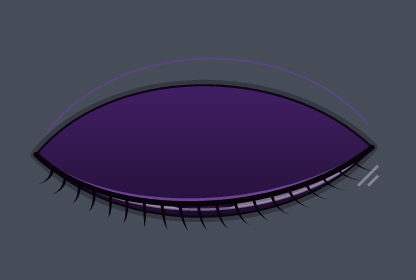

# GTA VI recomp PC status

A small Windows desktop widget that watches the open-source projects trying to run the Xbox Series build of
GTA VI on PC, and tells you when one of them makes real progress.

It is an eye that sits in a corner of your screen. Closed: nothing important happened. Open: something did.
Click it and a panel unfolds with a podium, the ranking and the latest changes.


| Closed | Open |
|---|---|
|  |  |

## What it does

- Reads the commit feed of each tracked project every 30 seconds.
- Reads the status table that VIctory, XCL and TuxBox keep in their README.
- Reads [PortWatch VI](https://portwatch-vi.xyz/) every 2 minutes for its list of tracked projects, their
  milestones and its news.
- Scores every project with PortWatch VI's own ladder (groundwork, exe runs, first frame, main menu, in-game,
  30 FPS, stable) and ranks them.
- Opens the eye, plays a sound and shows a tray balloon when a project changes milestone, when the leader
  changes, when a new project appears or when PortWatch publishes an article. Plain commits are listed but do
  not open the eye.

It only reads public pages. It downloads no game files, needs no account and sends nothing anywhere.

## Using it

- **Click the eye**: unfold or fold the panel.
- **Drag**: move it. The panel always unfolds towards the inside of the screen.
- **The two small strokes by the eye**: drag to resize.
- **Click a project**: its milestones, declared status and latest commits. A button there mutes that project.
- **Pin button**: keep it above other windows. **Dash button**: fold to the eye when pinned, otherwise hide it
  next to the clock.
- **Right-click** (eye or tray icon): language (English, French, Spanish), always on top, quit.

Position, size, language and muted projects are saved in `%APPDATA%\GtaPcWatch\settings.ini`.

## Building

Windows only. It needs nothing but the C# compiler that ships with .NET Framework 4.x:

```
window\build.cmd
```

This produces `window\GtaPcWatch.exe`. The build runs twice on purpose: the first pass makes the program,
which then draws its own icon, and the second pass embeds that icon.

- `window/GtaPcWatch.cs` is the polling engine.
- `window/EyeWindow.cs` is the window: the eye, the panel, the translations.

## Limits

- Scores are PortWatch VI's judgement, not a measurement. If their site stops updating, the ranking freezes.
- Statuses are what each author declares. Nothing here verifies them.
- Commit titles, declared statuses and PortWatch texts stay in English whatever the interface language.

## Disclaimer

This is a fan-made status tracker. It is not affiliated with Rockstar Games, Take-Two Interactive, Microsoft,
PortWatch VI or any of the projects it lists. It does not contain, download or help obtain any game file.
Anything offering a ready-made "GTA 6 PC" download is a scam or malware.
