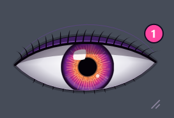
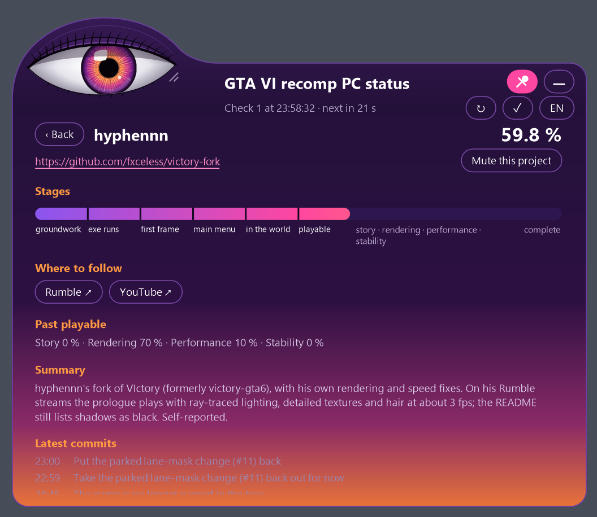

# GTA VI recomp PC status

**Follow the race to run GTA VI on PC, live, from a corner of your screen.**

A dozen open-source projects are racing to get the Xbox Series build of GTA VI running on Windows. This
widget watches all of them and tells you the moment one pulls ahead.


## The eye

It sits wherever you drop it. You do not have to look at it: it looks at the race for you.

| Nothing important happened | Something did |
|---|---|
|  |  |

The eye opens when a project reaches a new milestone, when the leader changes, when a new project appears or
when PortWatch VI publishes an article. A sound plays and the pink badge counts what you have not read yet.
Plain commits are listed in the panel but never open the eye.

## The race

Every project climbs the same ladder, from 0 to 100:

| Milestone | Score | What it means |
|---|---|---|
| Groundwork | 0 to 10 | loader, shader translation and graphics layer, before the game even starts |
| Exe runs | 10 | the game's own code starts running |
| First frame | 20 | logos, a loading screen or the intro |
| Main menu | 30 | the menu is reached and answers the controller |
| In the world | 40 | story mode loads into the game world and draws it, however broken |
| Playable | 50 | you control a character in the world |
| Complete | 100 | the whole game can be finished, looking and running like the console |

Past Playable, the other 50 points come from four tracks: story progress (35 %), rendering (25 %),
performance (average FPS ÷ 30, 20 %) and stability (20 %).

The bar at the top of the panel is drawn to that scale and filled up to the leader's score, the podium shows
the top three, and the list below shows who is chasing them.

Only public code is ranked, as on PortWatch VI. Private builds, which nobody else can check, are scored
and listed on their own line, without a rank.

This is PortWatch VI's scale as of 24 November 2026 (it was reworked that day). If they change it again, the
widget has to be updated to match, which is what the built-in updater is for.

## One project up close

Click any project to see its milestones, the status its author declares, and its latest commits as they land.
Too noisy? One button mutes that project.

When a team has a public channel of its own (Discord server, Rumble or YouTube streams, X account), the page
shows a button for each under "Where to follow". The list lives in [`links.txt`](links.txt) and is read again
every couple of minutes, so a dead link is fixed there, without a new release.



## Any corner, three languages

The panel grows out of the eye and always unfolds towards the inside of the screen, so the eye can live in any
corner. The interface is in English, French or Spanish.


## Using it

- **Click the eye**: unfold or fold the panel.
- **Drag**: move it.
- **The two small strokes by the eye**: drag to resize.
- **Pin button**: keep it above other windows.
- **Dash button**: fold back to the eye when pinned, otherwise hide next to the clock.
- **Right-click** the eye or the tray icon: language, always on top, check for updates, quit.

Hidden next to the clock, the tray icon is the eye itself: closed or open. A balloon announces important
changes.

Position, size, language and muted projects are saved in `%APPDATA%\GtaPcWatch\settings.ini`.

## How it follows the race

- Every 30 seconds: the commit feed of the three front-runners, and the status table they keep in their README.
- Every 2 minutes: PortWatch VI's data, and the commit feed of every project PortWatch tracks.
- Every 4 minutes: a search for new projects of the same kind.

It only reads public pages. It downloads no game files, needs no account and sends nothing anywhere. The
one thing it downloads is its own new version, from this repository.

A change of status has to be read twice in a row before it is announced, an empty or truncated answer is
treated as a failed read instead of news, and the same event is never announced twice within ten minutes.

## Updates

Download `GtaPcWatch.exe` from the [latest release](https://github.com/Epikou/gta-vi-recomp-watch/releases/latest).
From then on it keeps itself up to date: shortly after starting, and every three hours, it looks at the latest
release on this repository. If the version there is newer, it downloads the new program, checks it against
the SHA-256 published with the release, replaces itself and restarts where it was.

It only ever downloads from this repository's releases. To update by hand instead, use the right-click menu.

## Building

Windows only. It needs nothing but the C# compiler that ships with .NET Framework 4.x:

```
window\build.cmd
```

This produces `window\GtaPcWatch.exe`. The build runs twice on purpose: the first pass makes the program,
which then draws its own icon, and the second pass embeds that icon.

- `window/GtaPcWatch.cs` is the polling engine.
- `window/EyeWindow.cs` is the window: the eye, the panel, the translations.
- `window/Updater.cs` is the updater; the version number lives there.
- `window/Links.cs` reads `links.txt`, the channels where each project can be followed.
- `window/release.ps1` builds and publishes a release (`GtaPcWatch.exe` and `version.txt`).

## Limits

- The scores are PortWatch VI's judgement, not a measurement. If their site stops updating, the ranking freezes.
- Statuses are what each author declares. Nothing here verifies them.
- Some ranked projects have no public code. They are listed because PortWatch VI ranks them; their page links
  to the PortWatch article instead of a repository, and there are no commits to follow.
- Commit titles, declared statuses and PortWatch texts stay in English whatever the interface language.

## Credits

**[PortWatch VI](https://portwatch-vi.xyz/)** ([source](https://github.com/4lwayz/portwatch-vi)) does the real
work of following this race. This widget relies on it for:

- the milestone ladder and the scoring formula, reproduced here from their `scoring.js`;
- the list of tracked projects and the milestones credited to each;
- the news and the change log shown in the panel.

If you want the full picture, with sources and reasoning for every score, read their site. This is only a
window onto it.

Thanks also to the people building the projects being watched.

## Disclaimer

This is a fan-made status tracker. It is not affiliated with Rockstar Games, Take-Two Interactive, Microsoft,
PortWatch VI or any of the projects it lists. It does not contain, download or help obtain any game file.
Anything offering a ready-made "GTA 6 PC" download is a scam or malware.
